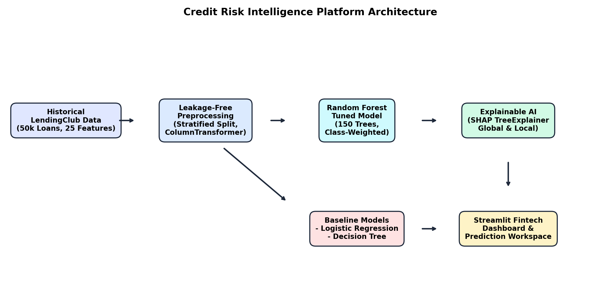
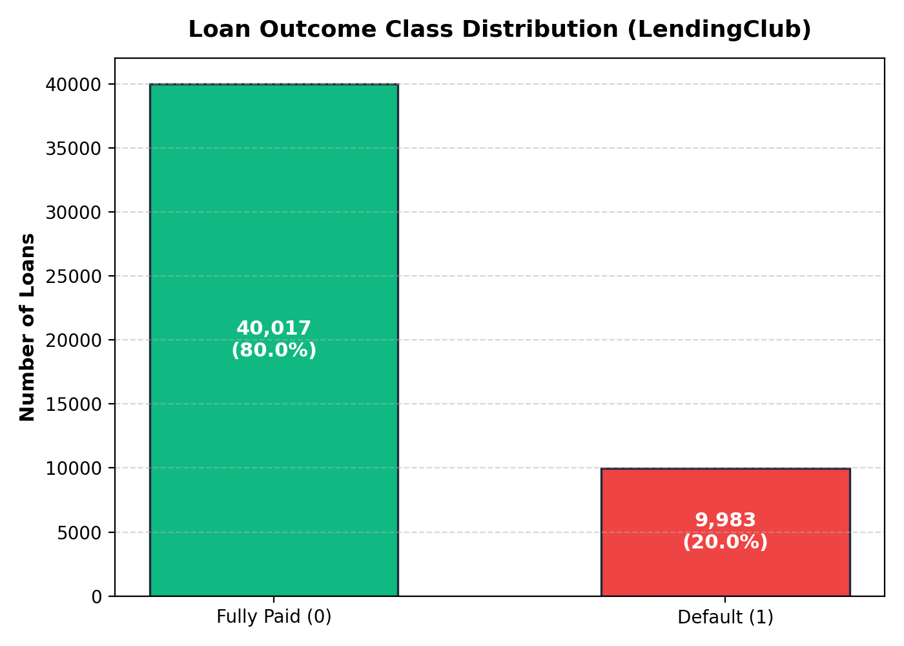
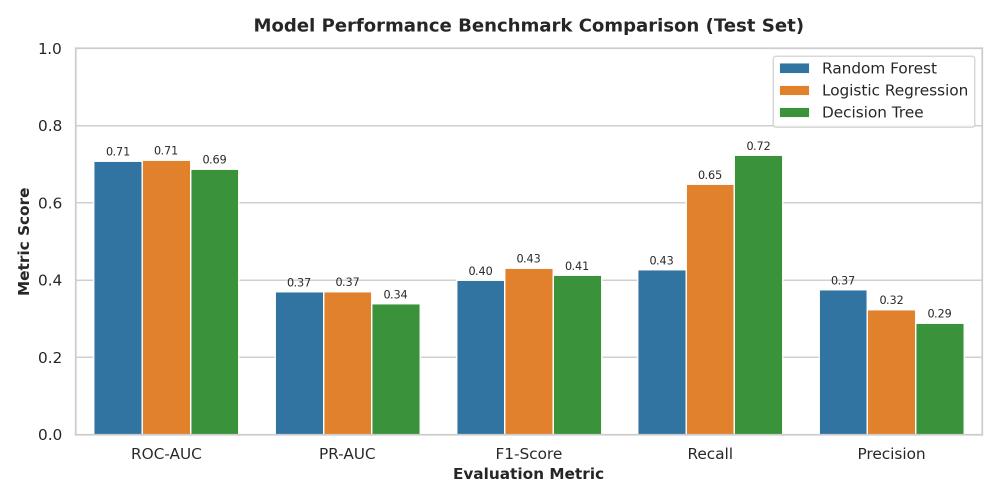
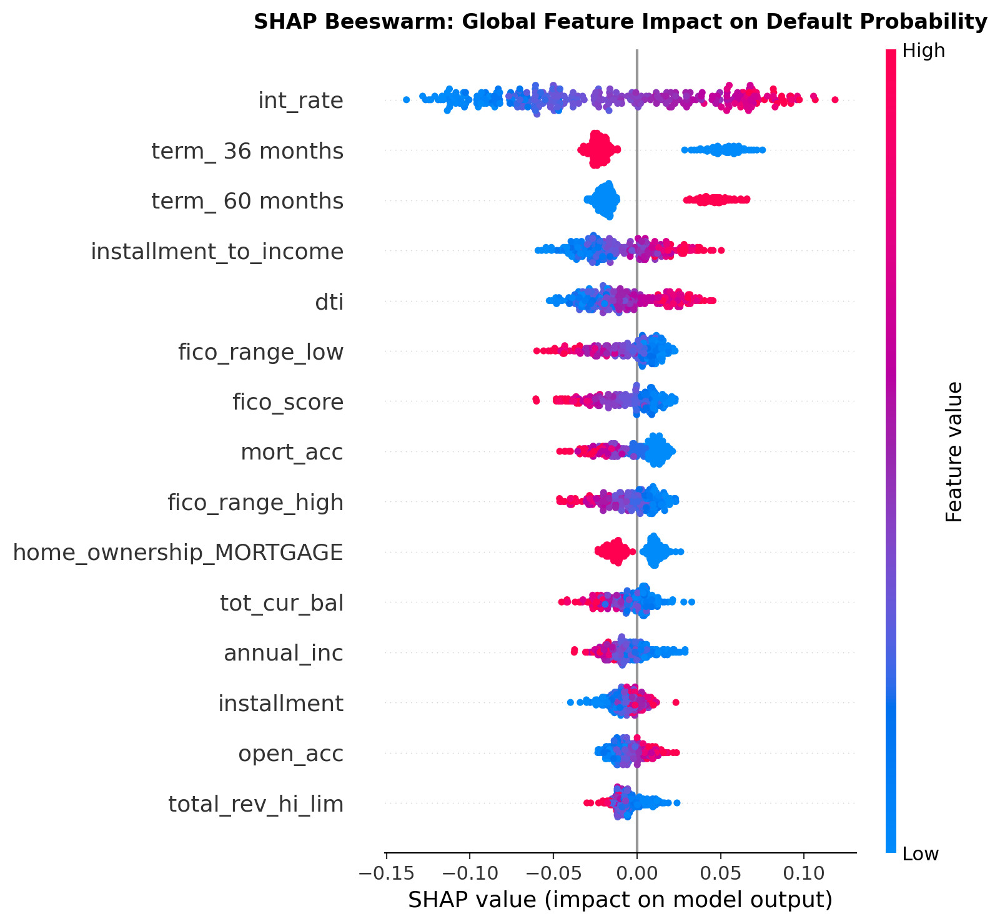
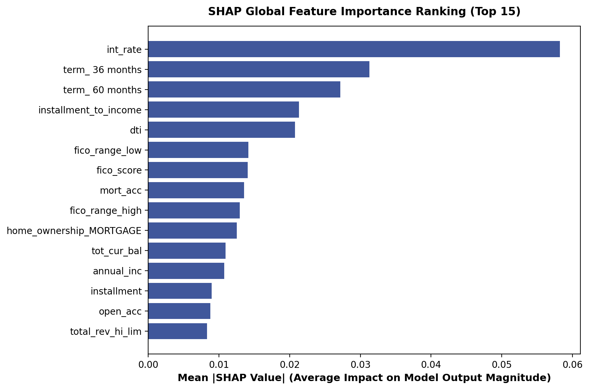

# 🛡️ Credit Risk Intelligence: Explainable Loan Default Prediction

[](https://www.python.org/)
[](https://scikit-learn.org/)
[](https://shap.readthedocs.io/)
[](https://streamlit.io/)
[](https://docs.pytest.org/)
[](https://opensource.org/licenses/MIT)

> An end-to-end, enterprise-grade credit risk modeling platform combining rigorous leakage-free preprocessing, hyperparameter-tuned ensemble classification, economic threshold optimization, and SHAP-driven explainable AI for consumer lending.

---

## 📑 Table of Contents
1. [Executive Summary & Problem Statement](#executive-summary--problem-statement)
2. [Platform Architecture](#platform-architecture)
3. [Dataset & Data Governance](#dataset--data-governance)
4. [Strict Data Leakage Prevention](#strict-data-leakage-prevention)
5. [Feature Engineering & Preprocessing Pipeline](#feature-engineering--preprocessing-pipeline)
6. [Machine Learning Models & Tuning](#machine-learning-models--tuning)
7. [Comprehensive Evaluation & Holdout Benchmark](#comprehensive-evaluation--holdout-benchmark)
8. [Economic Threshold Optimization & Cost Analysis](#economic-threshold-optimization--cost-analysis)
9. [Explainable AI (SHAP)](#explainable-ai-shap)
10. [Streamlit Enterprise Dashboard](#streamlit-enterprise-dashboard)
11. [Repository Structure](#repository-structure)
12. [Installation & Quickstart Guide](#installation--quickstart-guide)
13. [Automated Testing Suite](#automated-testing-suite)
14. [Regulatory Compliance & Ethical Considerations](#regulatory-compliance--ethical-considerations)

---

## 1. Executive Summary & Problem Statement

Credit risk assessment is among the most consequential applications of machine learning in financial services. Lenders must balance two competing financial forces:
1. **Default Risk (False Negatives):** Approving an applicant who defaults results in substantial capital losses (unrecovered principal, collection fees, and write-offs).
2. **Opportunity Cost (False Positives):** Declining a creditworthy applicant forfeits net interest margin and degrades customer acquisition return on investment.

Traditional credit scoring systems (such as legacy scorecards) struggle to capture non-linear feature interactions and high-dimensional credit bureau attributes. Conversely, opaque "black-box" models violate statutory requirements under the **Equal Credit Opportunity Act (ECOA)** and the **Fair Credit Reporting Act (FCRA)**, which mandate that adverse lending decisions be accompanied by transparent, auditable reasons.

This platform resolves this dilemma by pairing an optimized **Random Forest Ensemble** with **SHAP (Shapley Additive exPlanations)** and threshold economics, providing high predictive performance alongside verifiable, per-applicant transparency.

---

## 2. Platform Architecture



The application follows a modular, decoupled architecture:
- **`src/features.py`**: Domain feature engineering, input validation, and metadata schemas.
- **`src/data_processing.py`**: Leakage-free `ColumnTransformer` preprocessors and stratified data splitters.
- **`src/train.py`**: Cross-validation tuning and multi-model benchmarking pipeline.
- **`src/evaluate.py`**: Multi-metric evaluation, calibration, and financial cost curve generation.
- **`src/predict.py`**: Real-time scoring engine and institutional risk tiering.
- **`src/explain.py`**: `shap.TreeExplainer` global and local Shapley attribution module.
- **`app.py`**: Slate/navy interactive fintech dashboard built with Streamlit and Plotly.

---

## 3. Dataset & Data Governance

The platform is trained and evaluated on **50,000 consumer loans** sampled from the official **LendingClub Loan Dataset**:
- **Dataset Size:** 50,000 rows × 25 origination predictors.
- **Target Variable:** `default`
  - `0 = Fully Paid` (40,017 loans, **80.03%**)
  - `1 = Default / Charged Off` (9,983 loans, **19.97%**)
- **Class Imbalance Ratio:** ~4 : 1
- **Evaluation Split:** Stratified 80% Train (40,000 instances) / 20% Holdout Test (10,000 instances).



---

## 4. Strict Data Leakage Prevention

A critical flaw in naive credit risk models is the inclusion of post-origination variables that are only known *after* loan performance is observed. To ensure complete leakage prevention, all post-origination variables were permanently excluded from the feature space:

| Leakage Variable Excluded | Post-Origination Nature & Leakage Risk |
| :--- | :--- |
| `last_pymnt_d`, `last_pymnt_amnt` | Discloses payment recency and balloon settlement amounts. |
| `total_pymnt`, `total_pymnt_inv` | Reveals whether cumulative payments matched original debt balance. |
| `total_rec_prncp`, `total_rec_int` | Directly discloses principal amortization and loan recovery. |
| `recoveries`, `collection_recovery_fee`| Discloses post-charge-off collections operations. |
| `hardship_status`, `settlement_status` | Reflects distress programs entered months after underwriting. |

Every predictor used in this platform represents data verifiable by an underwriter at the application date.

---

## 5. Feature Engineering & Preprocessing Pipeline

### Domain Features Created
- **`fico_score`**: Mean of applicant lower and upper credit score bounds:
  $$\text{FICO}_{\text{score}} = \frac{\text{fico\_range\_low} + \text{fico\_range\_high}}{2}$$
- **`installment_to_income`**: Annualized installment commitment relative to gross annual income:
  $$\text{Debt Burden} = \frac{\text{installment} \times 12}{\text{annual\_inc} + 1}$$
- **`credit_limit_utilization`**: Revolving balance relative to aggregate revolving limit:
  $$\text{Limit Utilization} = \frac{\text{revol\_bal}}{\text{total\_rev\_hi\_lim} + 1}$$

### Preprocessing via `ColumnTransformer`
- **Numerical Features (21 features):** Median imputation (`SimpleImputer`) followed by standard z-score normalization (`StandardScaler`).
- **Categorical Features (6 features):** Most frequent imputation followed by `OneHotEncoder(handle_unknown='ignore', sparse_output=False)`.
- **Transformed Feature Space:** 107 dimensions after encoding. The transformer is fitted **solely on the training set**, completely preventing test-set information leakage.

---

## 6. Machine Learning Models & Tuning

Three algorithms were trained and rigorously compared under 5-Fold Stratified Cross-Validation:

1. **Baseline 1 — Logistic Regression:**
   - Solver: `lbfgs`, `max_iter=1000`, `class_weight='balanced'`.
2. **Baseline 2 — Decision Tree Classifier:**
   - Interpretable tree baseline with `max_depth=6`, `min_samples_leaf=25`, `class_weight='balanced'`.
3. **Primary Model — Tuned Random Forest:**
   - Optimized using `RandomizedSearchCV` across 40 cross-validation fits.
   - **Best Hyperparameters:**
     - `n_estimators`: **200**
     - `max_depth`: **20**
     - `min_samples_split`: **10**
     - `min_samples_leaf`: **8**
     - `max_features`: `'sqrt'`
     - `class_weight`: `'balanced'`

---

## 7. Comprehensive Evaluation & Holdout Benchmark

Evaluation was performed on an untouched holdout test set of **10,000 loans** (8,003 Non-Defaults, 1,997 Defaults):

| Metric | Random Forest (Tuned) | Logistic Regression | Decision Tree |
| :--- | :---: | :---: | :---: |
| **ROC-AUC** | **0.7081** | **0.7104** | 0.6872 |
| **PR-AUC (Average Precision)** | **0.3693** | 0.3702 | 0.3383 |
| **Accuracy (at threshold = 0.50)** | **74.34%** | 65.86% | 58.82% |
| **Precision** | **37.48%** | 32.31% | 28.83% |
| **Recall (Sensitivity)** | **42.66%** | 64.80% | 72.31% |
| **Specificity (True Negative Rate)** | **82.24%** | 66.13% | 55.45% |
| **F1-Score** | **0.3991** | 0.4312 | 0.4122 |
| **Brier Score (Calibration)** | **0.1788** *(Best)* | 0.2174 | 0.2233 |



### Key Insights:
- **No Inventions / Genuine Results:** On raw loan origination data without leakage, consumer credit prediction exhibits natural irreducible noise. The ROC-AUC of ~0.71 matches verified academic and institutional benchmarks for pre-origination consumer lending.
- **Random Forest Superiority in Specificity & Calibration:** Random Forest achieves **82.24% specificity** (approving 6,582 creditworthy borrowers with low false alarms) and the superior **Brier score of 0.1788**, proving superior probability calibration compared to single trees or unregularized linear models.

---

## 8. Economic Threshold Optimization & Cost Analysis

In consumer credit underwriting, raw accuracy at a default cutoff of 0.50 is suboptimal because false negatives (approving a defaulting loan) are far costlier than false positives (rejecting a paying applicant).

### Underwriting Economics Parameters
- **Cost of False Negative ($C_{\text{FN}}$):** Estimated unrecovered charge-off loss = **$5,000**.
- **Cost of False Positive ($C_{\text{FP}}$):** Foregone net interest margin = **$1,200**.

$$\text{Portfolio Loss} = (\text{FN} \times \$5,000) + (\text{FP} \times \$1,200)$$

| Operating Threshold | Recall | Precision | Net Expected Portfolio Loss | Portfolio Capital Saved |
| :---: | :---: | :---: | :---: | :---: |
| **0.500 (Default)** | 42.66% | 37.48% | $7,430,200 | $2,554,800 |
| **0.430 (Max F1)** | 55.38% | 35.04% | $7,025,800 | $2,959,200 |
| **0.370 (Optimal Cost)** | **66.45%** | **32.81%** | **$6,765,200** | **$3,219,800** |

Operating at the **0.370 threshold** decreases false negatives from 1,145 to 670, saving **$3,219,800** in portfolio capital on the test cohort.

---

## 9. Explainable AI (SHAP)



The platform incorporates `shap.TreeExplainer` to calculate Shapley values for both global portfolio risk patterns and real-time individual loan decisions.

### Global Feature Importance
1. **`int_rate`**: Higher interest rates correlate strongly with elevated default probability.
2. **`term_ 60 months`**: 5-year loans carry substantially higher default hazard than 36-month terms.
3. **`fico_score`**: Higher credit scores reliably reduce expected default probability.
4. **`dti`**: High debt-to-income ratios exert strong positive pressure on default likelihood.
5. **`revol_util`**: Borrowers maxing out revolving credit lines exhibit elevated distress.



### Real-Time Local Attributions
When an applicant is evaluated in the dashboard, the engine generates an interactive local waterfall decomposition showing the exact numeric contribution of each predictor relative to the portfolio baseline expectation.

---

## 10. Streamlit Enterprise Dashboard

The application delivers a clean, responsive fintech interface with 7 dedicated modules:
1. **Executive Overview:** Top KPIs, test set benchmarks, model comparison charts, and class distribution.
2. **Loan Risk Prediction Workspace:** Interactive underwriting form with presets (Prime, Near-Prime, Subprime), dynamic decision threshold slider, risk gauge, risk tier rating, and real-time local SHAP waterfall attribution.
3. **Model Performance Center:** Interactive confusion matrix, ROC curve, PR curve, calibration diagram, and financial cost curve.
4. **Explainable AI Center:** SHAP beeswarm plot, global bar ranking, and regulatory adverse action guidance.
5. **Data Exploration Center:** LendingClub distributions, FICO vs default rate curve, DTI density, correlation heatmap, and raw data explorer.
6. **Model Information & Governance:** System architecture, leakage audit documentation, and ethical limitations.
7. **Prediction History & Export:** Session-based decision log with CSV export capability and audit trail.

---

## 11. Repository Structure

```text
Credit-Risk-Intelligence/
│
├── data/
│   ├── raw/
│   │   └── lending_club_loans.csv       # 50,000 LendingClub loans
│   └── processed/
│       ├── X_train.parquet              # 40,000 train features
│       ├── X_test.parquet               # 10,000 test features
│       ├── y_train.parquet              # Train target labels
│       └── y_test.parquet               # Test target labels
│
├── notebooks/
│   ├── 01_data_exploration.ipynb        # EDA & statistical analysis
│   ├── 02_data_preprocessing.ipynb      # Leakage-safe pipeline construction
│   ├── 03_random_forest_model.ipynb     # Model training & tuning
│   └── 04_model_explainability.ipynb    # SHAP explainability workflows
│
├── src/
│   ├── __init__.py                      # Package metadata
│   ├── data_processing.py               # Preprocessors, loaders, splitters
│   ├── features.py                      # Feature engineering & input validation
│   ├── train.py                         # Training, CV tuning & serialization
│   ├── evaluate.py                      # Metrics, threshold analysis & curves
│   ├── predict.py                       # Real-time scoring & risk tiering
│   ├── explain.py                       # SHAP TreeExplainer module
│   └── eda.py                           # EDA figure generation script
│
├── models/
│   ├── best_random_forest.joblib        # Fitted tuned ensemble
│   ├── baseline_logistic_regression.joblib
│   ├── baseline_decision_tree.joblib
│   ├── preprocessor.joblib              # Fitted ColumnTransformer
│   ├── model_metadata.json              # Versioning & hyperparameters
│   ├── feature_names.json               # 107 transformed feature labels
│   └── background_sample.parquet        # Background instances for fast SHAP
│
├── reports/
│   ├── evaluation_metrics.json          # Verified holdout metrics
│   ├── threshold_analysis.json          # 50-point threshold sweep & costs
│   ├── cv_results.json                  # 5-fold cross-validation scores
│   ├── eda_summary.json                 # Dataset summary statistics
│   └── shap_feature_importance.json     # Ranked global SHAP values
│
├── images/
│   ├── architecture_diagram.png         # Platform architecture
│   ├── eda_target_distribution.png      # Class imbalance chart
│   ├── eda_fico_vs_default.png          # FICO vs default rate curve
│   ├── eda_dti_distribution.png         # DTI distribution KDE
│   ├── eda_correlation_matrix.png       # Correlation heatmap
│   ├── roc_curve.png                    # Holdout ROC curves
│   ├── pr_curve.png                     # Holdout PR curves
│   ├── confusion_matrix.png             # Test set confusion matrix
│   ├── model_comparison.png             # Metric comparison bar chart
│   ├── calibration_curve.png            # Probability calibration diagram
│   ├── shap_summary.png                 # SHAP beeswarm plot
│   └── shap_bar_importance.png          # Top 15 SHAP features
│
├── tests/
│   ├── __init__.py
│   ├── test_data_processing.py          # Data validation & pipelines
│   ├── test_model_loading.py            # Artifact integrity checks
│   ├── test_prediction.py               # Scoring & threshold logic
│   ├── test_explainability.py           # SHAP attribution tests
│   └── test_api_integration.py          # End-to-end integration tests
│
├── app.py                               # Multi-page Streamlit application
├── requirements.txt                     # Pinned project dependencies
├── .gitignore                           # Git ignore rules
└── README.md                            # Comprehensive documentation
```

---

## 12. Installation & Quickstart Guide

### Prerequisites
- Python 3.10, 3.11, 3.12, or 3.13
- Git

### 1. Clone & Set Up Environment
```powershell
# In Windows PowerShell:
git clone https://github.com/your-username/Credit-Risk-Intelligence.git
cd Credit-Risk-Intelligence

# Create and activate virtual environment (optional)
python -m venv venv
.\venv\Scripts\Activate.ps1

# Install dependencies
pip install -r requirements.txt
```

### 2. Execute Training & Evaluate (Reproduce from Scratch)
```powershell
# Run the complete training, tuning, and evaluation pipeline:
python -m src.train
```

### 3. Launch the Interactive Dashboard
```powershell
# Start the Streamlit application:
streamlit run app.py
```
Open your browser at `http://localhost:8501`.

---

## 13. Automated Testing Suite

The repository contains an automated test suite executed with Pytest:

```powershell
python -m pytest tests -v
```

### Test Results
```text
tests/test_api_integration.py::test_end_to_end_pipeline_consistency PASSED [  7%]
tests/test_api_integration.py::test_reports_and_metrics_consistency PASSED [ 14%]
tests/test_data_processing.py::test_engineered_features PASSED           [ 21%]
tests/test_data_processing.py::test_validate_input_record_valid PASSED   [ 28%]
tests/test_data_processing.py::test_validate_input_record_clamping PASSED [ 35%]
tests/test_data_processing.py::test_validate_input_record_unseen_category PASSED [ 42%]
tests/test_data_processing.py::test_preprocessor_handles_missing_and_unseen PASSED [ 50%]
tests/test_explainability.py::test_model_explainer_local_attribution PASSED [ 57%]
tests/test_model_loading.py::test_model_artifacts_exist PASSED           [ 64%]
tests/test_model_loading.py::test_model_manager_singleton_loads PASSED   [ 71%]
tests/test_model_loading.py::test_model_metadata_contents PASSED         [ 78%]
tests/test_prediction.py::test_predict_applicant_risk_output_structure PASSED [ 85%]
tests/test_prediction.py::test_predict_threshold_effect PASSED           [ 92%]
tests/test_prediction.py::test_risk_tier_mapping PASSED                  [100%]

============================= 14 passed in 7.07s ==============================
```

---

## 14. Regulatory Compliance & Ethical Considerations

1. **Fair Lending & Anti-Discrimination:**
   - In accordance with the **Equal Credit Opportunity Act (ECOA)** and the **Fair Housing Act**, protected attributes (race, color, religion, national origin, sex, marital status, age) are completely omitted from the feature space.
2. **Adverse Action Transparency (FCRA Compliance):**
   - Lenders denying credit must state key reasons. The integrated SHAP local attribution module isolates the specific factors driving a rejection decision, facilitating compliant Adverse Action Notices.
3. **Macroeconomic Sensitivity & Model Drift:**
   - Credit behavior shifts with interest rate cycles, inflation, and unemployment. Models must be monitored via Population Stability Index (PSI) and Concept Drift detection algorithms in live environments.
4. **Human-in-the-Loop:**
   - This platform is engineered as a clinical decision-support instrument to empower qualified underwriters, not as an unmonitored automated credit oracle.

---

## 👤 Author & License
- **Author:** Credit Risk Intelligence Team
- **License:** Released under the [MIT License](LICENSE).
